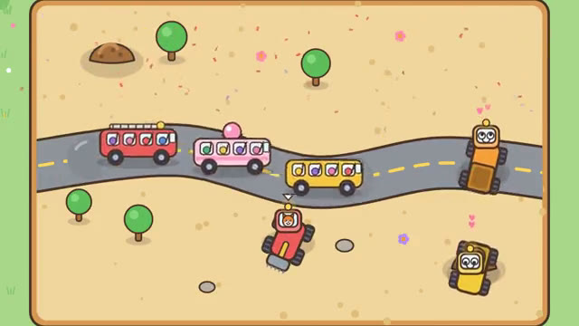

# Busy Diggers

Tap the dirt, tap the hole. Fill the road, then a parade! A multiplayer starter game from [Multiplayer Agent](https://multiplayeragent.com): 2D, co-op, 1–4 players, for little kids aged 2 to 5, with buddy trucks that help when nobody else is around.

## Who it is for

Children aged 2 to 5, on a phone or a tablet, usually with a grown-up or a sibling on a second device. Nothing on screen needs reading, there is no clock, no score and no way to lose. It collects nothing: no names, no chat, no scores, no logins.

## How it plays

Your child taps a dirt pile and their digger drives over and scoops it by itself, then taps a hole to tip it in (a bouncing arrow shows where to go next, and a drawn hand shows the tap when they pause). Fill every hole together and a steamroller and a parade roll across; then the next site slides in by itself: fix the road, fix the pond's bank so the ducks can cross, build the ramp to the bridge, or dig in the snow. Tapping your own digger honks its horn.

**Controls:** Tap or drag with one finger; the mouse works too (arrow keys drive as well).

## Make it yours in the Game Builder

Open the [Game Builder](https://multiplayeragent.com), choose **Start from a starter game** and pick Busy Diggers. It opens as version 1 in your studio, ready to play and publish. Then ask for changes, for example:

- Make them tractors on a farm, filling the barn with hay
- Add a cement mixer to the parade
- Count out loud every time a load goes in

## Run it yourself

1. Get a free publishable key (`pk_…`) at [multiplayeragent.com](https://multiplayeragent.com).
2. In `index.html`, put it in place of `pk_REPLACE_ME` in the `MP_CONNECT` block.
3. Open `index.html` in a browser. No build step and no server needed.

Without a key it still runs, offline with the buddy trucks.

## How it is built

- One `index.html`. The comment at the top of the script maps the code and explains the multiplayer.
- **Bots:** Buddy dump trucks help slowly and leave the last load to your child.
- **Live sync:** You see each other's diggers, fingers and every scoop at once.
- **Host-run rounds:** One player's browser keeps the site and the buddies; if it leaves, the next takes over.
- The sites are data (`THEMES` in the code): the road's shape, where the piles go, and who drives in the parade.
- `?attract` runs it offline with buddies only. The preview video is recorded from it.

## License

MIT.
